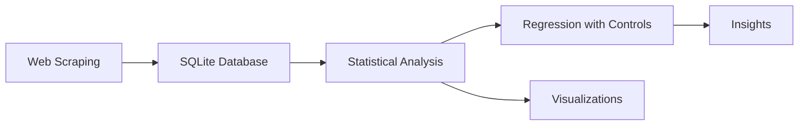

# 🍅 Rotten Tomatoes Analysis

<div align="center">


**Production-Grade Movie Data Pipeline with Statistical Analysis**

[]()
[](https://github.com/samalarakshithbabu/rotten-tomatoes-analysis/issues)

</div>

---

## 🚀 Executive Summary

A **comprehensive data pipeline** for scraping, storing, and analyzing Rotten Tomatoes movie data with proper statistical methods. Features Selenium scraping, SQLite storage, Kruskal-Wallis testing, and OLS regression with confounding control.

### What It Does



---

## ✨ Key Features

| Feature | Description |
|---------|-------------|
| **Web Scraper** | Selenium with Shadow DOM support |
| **Database** | SQLite with validation |
| **Statistics** | Kruskal-Wallis, effect sizes |
| **Regression** | OLS with genre/runtime/vote controls |
| **Visualizations** | Score distributions, correlation matrices |

---

## 📊 Statistical Methods

| Method | Purpose |
|--------|---------|
| **Kruskal-Wallis H-test** | Non-parametric group comparisons |
| **Effect Sizes** | ε², η², Cohen's d |
| **OLS Regression** | Control for confounding variables |
| **Mann-Whitney U** | Pairwise comparisons |

---

## 🛠️ Technology Stack

| Component | Technology |
|-----------|------------|
| **Scraping** | Selenium |
| **Database** | SQLAlchemy + SQLite |
| **Statistics** | scipy, statsmodels, pingouin |
| **Visualization** | matplotlib, seaborn, plotly |

---

## 📁 Project Structure

```
rotten-tomatoes-analysis/
├── scraper/                   # Web scraping module
│   ├── config.py
│   └── scraper.py
├── database/                  # Database layer
│   ├── models.py
│   └── schema.py
├── analysis/                  # Statistical analysis
│   ├── statistics.py
│   ├── regression.py
│   └── visualization.py
├── docs/                      # Documentation
├── data/                      # Data exports
├── requirements.txt
├── main.py                    # CLI entry point
└── README.md
```

---

## 🛠️ Installation

```bash
pip install -r requirements.txt
```

### Quick Start

```bash
# Full pipeline with CSV import
python main.py pipeline --csv rotten_tomatoes_700.csv

# Scrape fresh data
python main.py scrape --records 1500

# Run analysis
python main.py analyze
```

---

## 📈 Key Findings

| Finding | Statistical Significance |
|---------|-------------------------|
| **Decade Effects** | Kruskal-Wallis p < 0.001 |
| **Genre Impact** | Horror ~12 points lower |
| **Runtime Correlation** | +0.12 per minute |
| **Vote Count** | Controls included in regression |

---

## ⚠️ Limitations

| Limitation | Description |
|------------|-------------|
| **Rate Limiting** | Scraping may be blocked |
| **API Keys** | Some features require external APIs |

---

## 📄 License

This project is licensed under the MIT License.

---

## 👨‍💻 Author

**SAMALA RAKSHITH BABU**

- 📧 Email: samalarakshithbabu7@gmail.com
- 💼 LinkedIn: [samala-rakshith-babu](https://www.linkedin.com/in/samala-rakshith-babu/)
- 🐙 GitHub: [samalarakshithbabu](https://github.com/samalarakshithbabu)